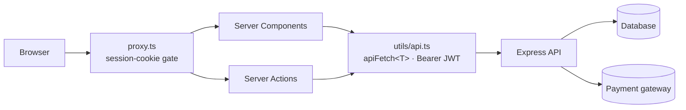

<div align="center">

# Atelier · Fashion for everyone

**A modern fashion storefront with size & color variants, gender collections, online payment and a
sales dashboard, built with Next.js 16 Server Components in front of an Express REST API.**


</div>

---

## Overview

**Atelier** is a clothing e-commerce frontend where every product has **variants**: shoppers pick a
size and a color, filter by gender and category, and check out through a payment gateway. Admins get a
**sales dashboard** with every order, including tax, shipping and payment status.

All data is fetched and mutated **on the server** (React Server Components + Server Actions) through one
typed gateway. The session JWT lives in an **`httpOnly` cookie**, so the browser never holds a readable token.

## Features

| Area | What it does |
| --- | --- |
| 👕 **Variants** | Sizes & colors per product, chosen on the product page and stored per cart line |
| 🔎 **Discovery** | Gender + category filters, debounced search, featured collection |
| 🛒 **Cart** | Per-variant lines, quantity control, totals computed by the backend |
| 💳 **Payments** | Order creation, pay-now for pending orders, `/payment-result` callback page |
| ⭐ **Reviews** | Leave, list and delete your own reviews |
| 📊 **Admin** | Product CRUD with image upload, plus a **sales table** of all orders (tax, shipping, status) |
| 🎨 **UX** | Dark mode, skeleton loaders, toasts, share buttons, responsive grid/list views |

## Architecture



```
app/
├── (root)/         # products, product/[id], cart, favorites, orders, reviews, payment-result
├── (dashboard)/    # /admin/products, /admin/sales
├── (auth)/         # sign-in / sign-up
utils/api.ts        # typed data gateway + every Server Action
utils/type.ts       # API contract types
proxy.ts            # redirects anonymous users away from private pages
```

## Security

- 🍪 JWT in an `httpOnly`, `Secure` (prod), `SameSite=Lax` cookie, unreachable from client JS.
- 🧾 Register/login send only whitelisted fields, never the raw `FormData`, which blocks mass-assignment attempts.
- 🧱 Every ID interpolated into an API URL is `encodeURIComponent`-encoded.
- 🛡️ Security headers: HSTS, `X-Frame-Options: DENY`, `nosniff`, `Referrer-Policy`, `Permissions-Policy`, and no `X-Powered-By`.
- 🔁 The proxy gate is a UX layer. The backend re-verifies the token and the `ADMIN` role on every call.

## Getting started

```bash
git clone https://github.com/n1j10/clothes-store.git
cd clothes-store
npm install
cp .env.example .env.local
npm run dev        # http://localhost:3000 (expects the API on :5000)
```

| Variable | Required | Description |
| --- | :---: | --- |
| `API_URL` | ✅ | Express backend base URL incl. `/api` |
| `NEXT_PUBLIC_WEBSITE_URL` | ➖ | Canonical site URL for share links |

| Command | Purpose |
| --- | --- |
| `npm run dev` / `build` / `start` | Develop, build, serve |
| `npx tsc --noEmit` | Type-check |

## Tech stack

**Framework** Next.js 16 · React 19 · TypeScript · Server Actions
**UI** Tailwind CSS v4 · shadcn/ui · Base UI · Embla · Lucide · Sonner
**Validation** Zod 4 · **Backend** Express REST API (JWT)

Deployed on **Vercel**.

---

<div align="center">

Built by **[n1j10](https://github.com/n1j10)**

</div>
